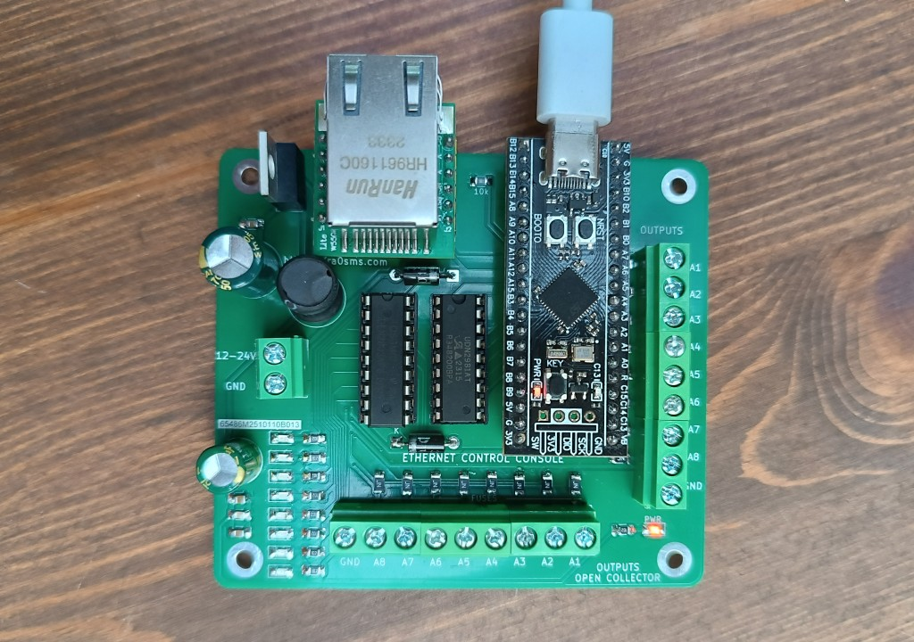
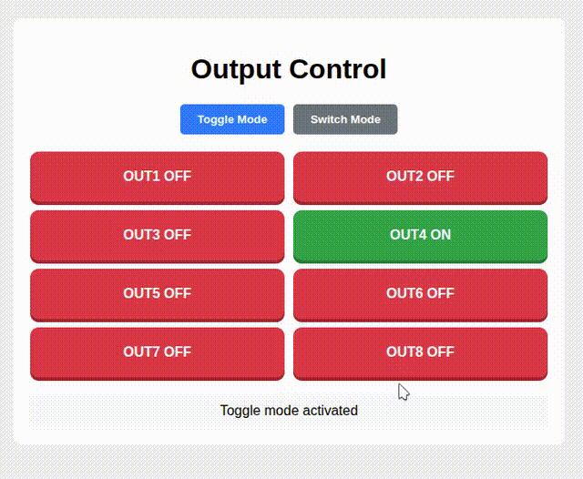
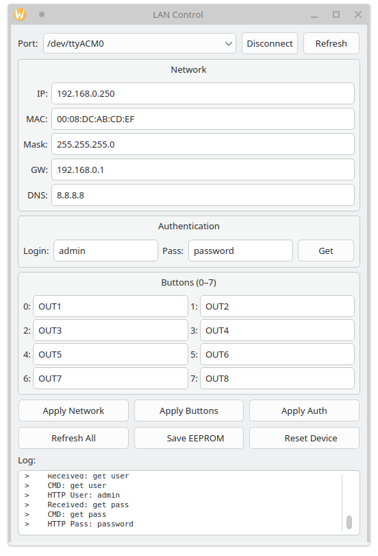
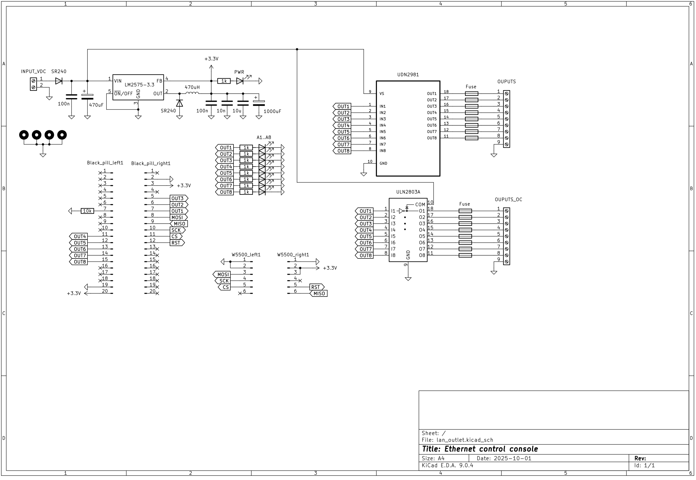
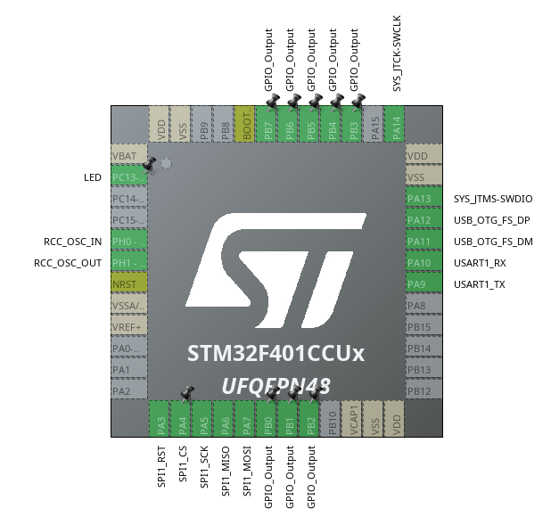
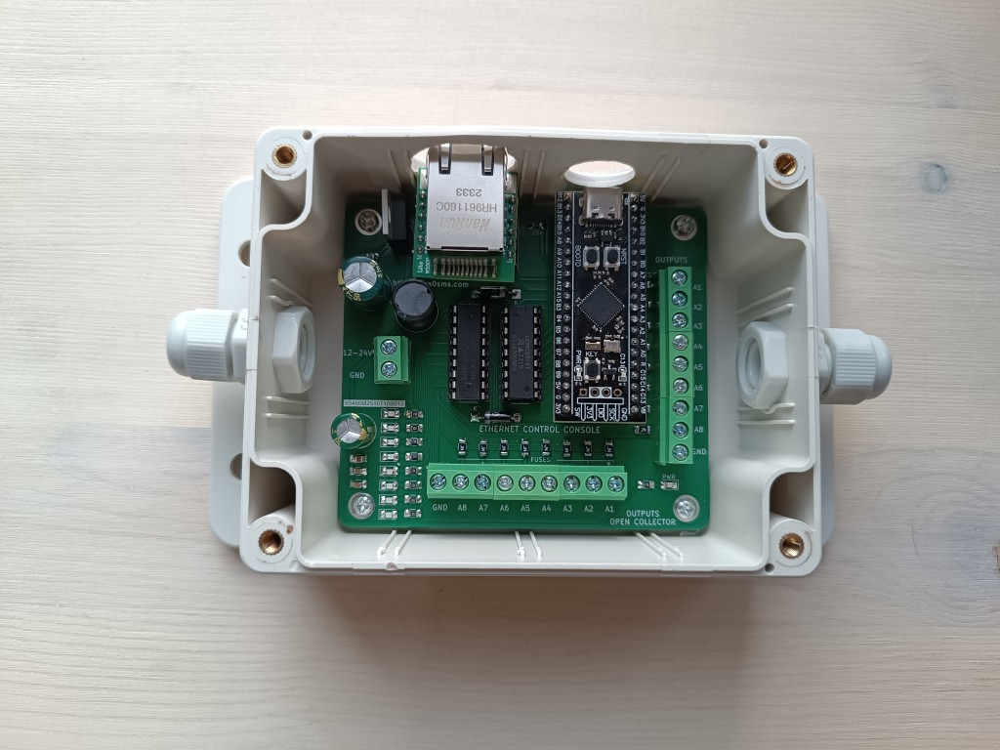

# Ethernet control console

A device for controlling 8 outputs over Ethernet using a built-in web interface. The main outputs switch voltage, and each one is duplicated by an open-collector output.

It is built on an STM32F401 (Black Pill) and a W5500 Ethernet controller. You can configure it over USB with a console or the GUI application.

- Wi-Fi version with the same functionality: [ESP8266_antenna_switch](https://github.com/ra0sms/ESP8266_antenna_switch)
- More information: https://ra0sms.com/ethernet-control-console



## Specifications

| Parameter | Value |
|---|---|
| Input voltage | 5–45 V DC |
| Output current | 500 mA total for all 8 outputs (and 500 mA total for open-collector outputs) |
| Interface | Ethernet 10/100 (W5500), USB (virtual COM port) |
| MCU | STM32F401CCU6 / STM32F401CEU6 (Black Pill) |
| PCB size | 78 × 88 mm |

## Operating modes

You select the mode in the web interface. It is saved together with the other settings.

| Mode | Behavior |
|---|---|
| **Toggle** | Each output toggles independently |
| **Switch** | Only one output is on at a time; turning one on turns the others off |
| **Dual** | Outputs 1–4 and 5–8 form two groups, each with its own Toggle/Switch mode |

## Firmware

Prebuilt firmware is in [firmware/](firmware/):

- `w5500_outlet.hex` – contains its own addresses
- `w5500_outlet.bin` – write to address `0x08000000`

### Flashing with ST-Link

STM32CubeProgrammer:

```sh
STM32_Programmer_CLI -c port=SWD -w firmware/w5500_outlet.hex -v -rst
```

st-flash:

```sh
st-flash --reset write firmware/w5500_outlet.bin 0x08000000
```

### Flashing over USB (DFU)

1. Hold **BOOT0**, press and release **NRST**, then release BOOT0.
2. Flash with STM32CubeProgrammer (`-c port=USB1`) or `dfu-util`:

```sh
dfu-util -a 0 -s 0x08000000:leave -D firmware/w5500_outlet.bin
```

> Settings are stored in flash sector 5 (`0x08020000`–`0x0803FFFF`), separately from the firmware. A normal firmware update keeps the settings. A full chip erase resets them to defaults.

## Default settings

| Parameter | Value |
|---|---|
| IP | 192.168.0.250 |
| Subnet mask | 255.255.255.0 |
| Gateway | 192.168.0.1 |
| DNS | 8.8.8.8 |
| MAC | 00:08:DC:AB:CD:EF |
| Web login / password | `admin` / `password` |

If you use more than one device on the same network, give each one its own IP and MAC address.

## Web interface

Open `http://<device IP>/` in a browser and log in (HTTP Basic Auth).



## USB configuration

When you connect the board over USB, it appears as a virtual COM port (STM32 Virtual ComPort). Any port speed works.

You can configure it without the W5500 or the rest of the circuit: a bare Black Pill on USB is enough. The firmware detects the W5500 automatically and starts the web server when the module is connected.

### Configuration software

[gui/](gui/) contains a GUI application: `gui.py` (Python 3, `pyserial`, `PyQt5`) and a Windows build in `gui-lan.zip`.



### Console commands

| Command | Description |
|---|---|
| `help` | List commands |
| `network` | Show network settings |
| `set ip <x.x.x.x>` | Set IP address |
| `set subnet <x.x.x.x>` | Set subnet mask (alias: `sn`) |
| `set gateway <x.x.x.x>` | Set gateway (alias: `gw`) |
| `set dns <x.x.x.x>` | Set DNS server |
| `set mac <xx:xx:xx:xx:xx:xx>` | Set MAC address |
| `set user <name>` | Set web login (1–31 characters) |
| `set pass <password>` | Set web password (up to 31 characters) |
| `get <ip\|mac\|subnet\|gateway\|dns\|user\|pass>` | Show a parameter |
| `buttons` | Show output names |
| `setbutton <0-7> <name>` | Rename an output (up to 15 characters) |
| `save` | Save settings to flash |
| `load` | Load settings from flash |
| `default` | Reset to factory defaults and save |
| `reset` | Reboot the device |

Changes take effect immediately, but they are saved only after `save`.

Example:

```
set ip 192.168.1.50
set gateway 192.168.1.1
setbutton 0 Antenna1
save
reset
```

## Hardware

### Schematic



### Pinout

| Function | STM32 pins |
|---|---|
| Outputs 1–8 | PB0–PB7 |
| W5500 SPI (SCK / MISO / MOSI) | PA5 / PA6 / PA7 |
| W5500 CS | PA4 |
| W5500 RST | PA3 |
| Status LED | PC13 |



### Boxed version



## Building from source

The project is in [code/](code/) and is built with STM32CubeIDE (open `code/` as an existing project). PCB files are in [KiCad/](KiCad/).

To build from the command line, use the toolchain bundled with STM32CubeIDE (the generic `arm-none-eabi-gcc` does not support the `-fcyclomatic-complexity` flag):

```sh
export PATH=/opt/st/stm32cubeide_<version>/plugins/com.st.stm32cube.ide.mcu.externaltools.gnu-tools-for-stm32.<version>/tools/bin:$PATH
cd code/Debug && make -j8 all
```

## License

See [LICENSE](LICENSE).
